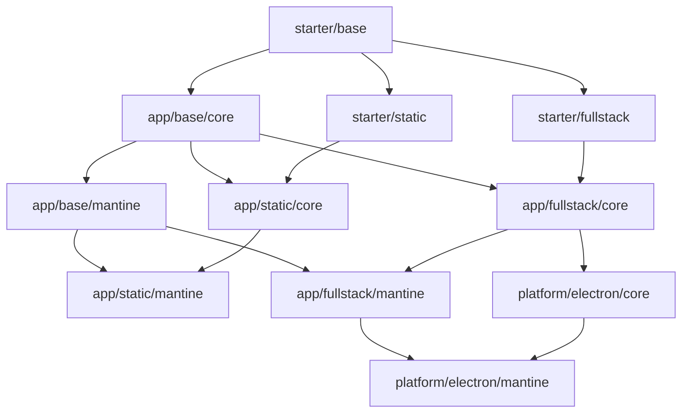

# Branch Architecture and Merge Contract

This repository maintains layered React Router Framework templates as long-lived branches combined by one-way merges. Capabilities are implemented once on their owning source branch and propagated downstream via `cascade/cascade.ts`.

This `main` branch is an orphan maintenance branch. It shares no history with template branches and must never be merged into them.

## Topology

Arrows indicate permitted merge directions.



| Branch | Direct Upstreams | Role | Maintenance |
| --- | --- | --- | --- |
| `starter/base` | — | Workspace toolchain and base React Router app (`SSR=false` opt-in) | Source |
| `starter/static` | `starter/base` | Static SPA (`ssr: false`), Node static server, nginx image | Source |
| `starter/fullstack` | `starter/base` | Hono host, `@repo/server` BFF, CSP, logging, graceful shutdown, Docker | Source |
| `app/base/core` | `starter/base` | UI-agnostic app foundation (`@repo/shared`, `AppRoot`, layouts, visual preferences) | Source |
| `app/static/core` | `starter/static`, `app/base/core` | Static runtime + App Core | Integration |
| `app/fullstack/core` | `starter/fullstack`, `app/base/core` | Fullstack runtime + App Core with host and CSP wiring for Core visual preferences | Integration |
| `app/base/mantine` | `app/base/core` | Mantine provider, styles, Core visual theme adapter | Source |
| `app/static/mantine` | `app/static/core`, `app/base/mantine` | Static runtime + App Core + Mantine | Integration |
| `app/fullstack/mantine` | `app/fullstack/core`, `app/base/mantine` | Fullstack runtime + App Core + Mantine | Integration |
| `platform/electron/core` | `app/fullstack/core` | Electron main/preload/utility host, IPC/transport packages, packaging & verification | Source |
| `platform/electron/mantine` | `platform/electron/core`, `app/fullstack/mantine` | Electron + App Core + Mantine | Integration |

## Layer Boundaries

- **`starter/base`**: Universal workspace tooling, base styles, and default SSR/SPA-capable app skeleton.
- **`starter/static`**: Disables server rendering via `ssr: false` without deleting base files that remain shared.
- **`starter/fullstack`**: Owns `packages/server`, `apps/web/src/host`, `apps/web/server.ts`, `entry.server.tsx`, `apps/web/src/app/lib/api.ts`, and CSP nonce wiring.
- **`app/base/core`**: Must not depend on Hono, Electron, or any UI component library. Feature routes use client data APIs (`clientLoader`/`clientAction`). Core owns the visual cookie configuration, shared cookie reads and writes, and the request-seed reader used by the root loader.
- **`@repo/shared`**: Core owns `Shell`, `WindowChromeBridge`, and window bootstrap/appearance contracts. Electron extends the same package with `desktop-headers.ts`, `preferences.ts`, `desktop-protocol.ts`, IPC channels, and `shellFromEnv()`. Pure web branches must never contain Electron host protocol files or symbols.
- **`app/base/mantine`**: Integrates Mantine as a derived consumer of Core's visual state via a custom `colorSchemeManager` and CSS layer ordering; never duplicates Core's localStorage authority or prepaint script.
- **`platform/electron/core`**: Embeds the Hono host in the Electron utility process (`app://` via `@repo/port-fetch`). Owns `apps/desktop`, `packages/channel`, `packages/port-fetch`, `bench/transport`, and `apps/web/src/app/platform/electron`.
- **Editor demo and window appearance**: Core owns the CRM and editor layouts, fused header columns, and per-document color scheme. Mantine owns its editor control and provider integration. Electron applies the appearance to the native window and synchronizes the application preference across desktop windows.
- **Integration branches**: Do not develop shared features directly. Fix bugs on the owning source branch and merge downstream. Keep integration-specific glue minimal and isolated in dedicated commits.

## Shared File Conventions

- **`AppRoot` and `AppUiProvider`**: `AppRoot` wires `EnvironmentContext.Provider` → `ManagersRegistry` → `VisualManagerRegistry` → `VisualManagerProvider`. `AppUiProvider` is a transparent slot inside `<body>` on Core and hosts the UI library provider on Mantine.
- **`root.tsx`**: Core seeds visual preferences in the root loader and adds the prepaint script, visual attributes, and `AppUiProvider`. Fullstack wires the CSP nonce into the root. Electron maps `shell` and `desktop` loader seeds into `AppRoot` and injects the native visual mirror as a VisualManager source.
- **Visual preferences and CSP**: Core injects a self-contained prepaint inline script in `<head>`. Fullstack passes the per-request CSP nonce in SSR mode and authorizes static/prerendered inline scripts by `sha256` hash (so the script must remain deterministic at build time). Mantine appends `data-mantine-color-scheme` via `visual-integration.ts`.
- **Package manifests (`package.json`)**: Layer-specific root scripts use layer suffixes (`*:server`, `*:desktop`, e.g. `dev:server`, `build:desktop`, `package:desktop`). Dependency maps are kept alphabetically sorted; textual conflicts are resolved by `cascade/package-merge.ts`.
- **Docs (`README.md`, `AGENTS.md`, `docs/specs/`)**: Template branches ship only `docs/specs/*.spec.md` under `docs/` and keep self-contained root `README.md` / `AGENTS.md`. Layers prefer adding dedicated `##` sections to minimize merge conflicts.

## Merge and Cascade Contract

### Rules

1. **Forward-only history**: Always merge upstreams with `--no-ff`. Never squash upstream history, rebase long-lived branches, reverse-merge downstream into upstream, or merge laterally between sibling branches.
2. **Propagation order**: Follow `cascade/topology.json` (upstreams before descendants). Local changes on a source branch propagate only to its descendants.
3. **Conflict policy**:
   - Never use `-X ours`. Do not add `.gitattributes` merge drivers to template branches.
   - Keep merge commits limited to conflict resolution; place any extra integration adaptation in a separate commit.
4. **No automatic push**: Cascade updates local refs atomically via compare-and-swap; pushing to remotes is an explicit manual step.

### Cascade CLI (`cascade/cascade.ts`)

Requires Node.js 24+ (native TypeScript execution) and pnpm. Run from the repository root on `main`:

```bash
node cascade/cascade.ts                 # Cascade and verify all enabled branches
node cascade/cascade.ts --force-checks  # Ignore verified commit cache and recheck all branches
node cascade/cascade.ts --dry-run       # Merge and verify without updating any branch refs
node cascade/cascade.ts --skip-checks   # Merge only (for conflict triage, not for release)
node cascade/cascade.ts --repo <path> --topology <file> --keep-worktree
```

Or via `package.json` scripts: `node --run test`, `node --run audit:branches`, `node --run cascade:dry-run`, `node --run cascade`.

Execution stages:

1. **Topology validation**: Rejects duplicate branches, missing upstreams, enabled branches depending on disabled ones, and cycles; sorts enabled branches topologically.
2. **Snapshot**: Records the starting tip of every enabled branch and fails early if any enabled branch is checked out with uncommitted changes (except under `--dry-run`).
3. **Isolated merges**: Processes branches in a temporary detached worktree. For each upstream not yet an ancestor of the branch, creates one `--no-ff` merge commit (`--no-verify` skips staged-file hooks because full checks run on the whole tree afterward). Already-merged upstreams are skipped.
4. **Conflict handling**:
   - `git rerere` replays prior resolutions (shared via `.git/rr-cache`).
   - `package.json` conflicts use three-way semantic key merging across all merge bases; same-key divergence or delete-modify conflicts stop for manual resolution.
   - `pnpm-lock.yaml` conflicts always stop the branch and block its descendants for manual resolution so independent dependency updates on both sides are preserved before running `pnpm install --lockfile-only`.
   - Unresolved conflicts abort the merge, mark the branch `conflict`, and block all descendants.
5. **Verification**: Runs `pnpm install --frozen-lockfile`, `lint`, `fmt:check`, `typecheck`, `vitest run`, and `build` with `CI=1` (preventing Lefthook from rewriting shared Git hooks). Logs are written to `.git/cascade/<timestamp>/<branch>.log`, and passing commits are recorded in `.git/cascade/verified.json`. Unverified tips (manual merges or direct source commits) are checked even when no upstream merge is pending. Electron smoke and packaged release checks are run separately before releasing Electron changes.
6. **Atomic publication**: Moves each verified branch ref via `git update-ref --stdin` compare-and-swap against its starting tip and parent tips. Refuses to move a branch currently checked out in a worktree (detach that worktree HEAD first, or run from `main`).

Run reports are written to `.git/cascade/<timestamp>/report.json`. Exit code is `1` if any branch failed, conflicted, or was blocked.

### Conflict Recovery

Resolve the reported conflict directly on the target branch (with `rerere` enabled so future runs reuse the resolution), then rerun cascade:

```bash
git -c rerere.enabled=true switch <branch>
git -c rerere.enabled=true merge <upstream>
# resolve conflicts, git add, git commit
git switch main
node cascade/cascade.ts
```

### Boundary Audit (`cascade/audit.ts`)

`node cascade/audit.ts` performs read-only checks against all enabled branches without changing working trees:

- Upstream ancestry (`merge-base --is-ancestor`).
- Layer file ownership (`cascade/ownership.ts`) and forbidden retired web paths.
- Absence of Electron host protocol symbols in non-Electron Core branches.
- Optional `--reference <path>` inventory diff against an external reference checkout.
