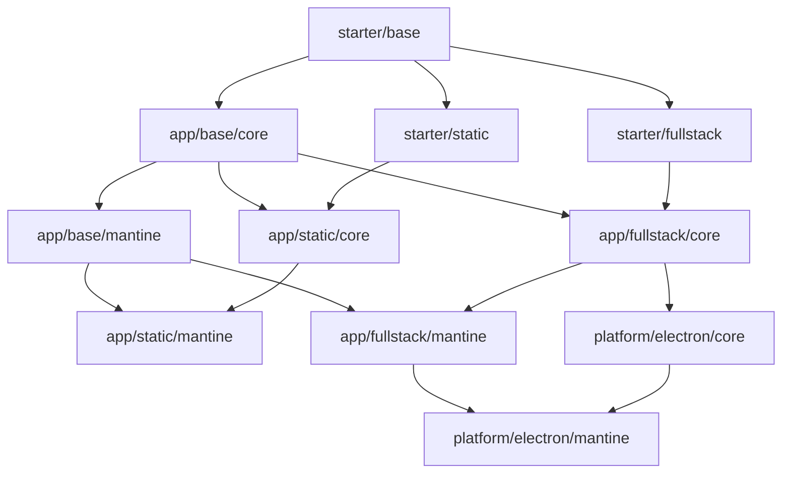

# Branch Architecture and Merge Contract

This repository maintains layered React Router Framework templates as long-lived branches combined by one-way merges. Capabilities are implemented once on their owning source branch and propagated downstream via `tools/cascade`.

This `main` branch is an orphan maintenance branch. It shares no history with template branches and must never be merged into them.

## Topology

Arrows indicate permitted merge directions.

| Branch | Direct Upstreams | Role | Maintenance |
| --- | --- | --- | --- |
| `starter/base` | — | Workspace toolchain and base React Router app (`SSR=false` opt-in) | Source |
| `starter/static` | `starter/base` | Static SPA (`ssr: false`), Node static server, nginx image | Source |
| `starter/fullstack` | `starter/base` | Hono host, `@repo/server` BFF, CSP, logging, graceful shutdown, Docker | Source |
| `app/base/core` | `starter/base` | UI-agnostic app foundation (`@repo/shared`, `AppRoot`, layouts, visual preferences) | Source |
| `app/static/core` | `starter/static`, `app/base/core` | Static runtime + App Core | Integration |
| `app/fullstack/core` | `starter/fullstack`, `app/base/core` | Fullstack runtime + App Core + optional visual cookie mirror | Integration |
| `app/base/mantine` | `app/base/core` | Mantine provider, styles, Core visual theme adapter | Source |
| `app/static/mantine` | `app/static/core`, `app/base/mantine` | Static runtime + App Core + Mantine | Integration |
| `app/fullstack/mantine` | `app/fullstack/core`, `app/base/mantine` | Fullstack runtime + App Core + Mantine | Integration |
| `platform/electron/core` | `app/fullstack/core` | Electron main/preload/utility host, IPC/transport packages, packaging & verification | Source |
| `platform/electron/mantine` | `platform/electron/core`, `app/fullstack/mantine` | Electron + App Core + Mantine | Integration |

## Layer Boundaries

- **`starter/base`**: Universal workspace tooling, base styles, and default SSR/SPA-capable app skeleton.
- **`starter/static`**: Disables server rendering via `ssr: false` without deleting base files that remain shared.
- **`starter/fullstack`**: Owns `packages/server`, `apps/web/src/host`, `apps/web/server.ts`, `entry.server.tsx`, `apps/web/src/app/lib/api.ts`, CSP nonce wiring, and server-side visual cookie helpers.
- **`app/base/core`**: Must not depend on Hono, Electron, or any UI component library. Routes use client data APIs (`clientLoader`/`clientAction`) so Core works identically in SSR and static SPA builds.
- **`@repo/shared`**: Core owns `Shell`, `WindowChromeBridge`, and window bootstrap/appearance contracts. Electron extends the same package with `desktop-headers.ts`, `preferences.ts`, `desktop-protocol.ts`, IPC channels, and `shellFromEnv()`. Pure web branches must never contain Electron host protocol files or symbols.
- **`app/base/mantine`**: Integrates Mantine as a derived consumer of Core's visual state via a custom `colorSchemeManager` and CSS layer ordering; never duplicates Core's localStorage authority or prepaint script.
- **`platform/electron/core`**: Embeds the Hono host in the Electron utility process (`app://` via `@repo/port-fetch`). Owns `apps/desktop`, `packages/channel`, `packages/port-fetch`, `bench/transport`, and `apps/web/src/app/platform/electron`.
- **Integration branches**: Do not develop shared features directly. Fix bugs on the owning source branch and merge downstream. Keep integration-specific glue minimal and isolated in dedicated commits.

## Shared File Conventions

- **`AppRoot` and `AppUiProvider`**: `AppRoot` wires `EnvironmentProvider` → `ManagersRegistry` → `VisualManagerRegistry` → `VisualManagerProvider`. `AppUiProvider` is a transparent slot inside `<body>` on Core and hosts the UI library provider on Mantine.
- **`root.tsx`**: Each layer touches only its own seam—Fullstack adds the root loader and CSP nonce; Core adds the prepaint script, visual attributes, and `AppUiProvider`; Electron maps `shell` and `desktop` loader seeds into `AppRoot` and mounts `DesktopVisualSync` inside `AppRoot`.
- **Visual preferences and CSP**: Core injects a self-contained prepaint inline script in `<head>`. Fullstack passes the per-request CSP nonce in SSR mode and authorizes static/prerendered inline scripts by `sha256` hash (so the script must remain deterministic at build time). Mantine appends `data-mantine-color-scheme` via `visual-integration.ts`.
- **Package manifests (`package.json`)**: Layer-specific scripts use layer prefixes (`server:*`, `desktop:*`). Dependency maps are kept alphabetically sorted; textual conflicts are resolved by `tools/cascade/package-merge.ts`.
- **Docs (`README.md`, `AGENTS.md`, `docs/specs/`)**: Template branches ship only `docs/specs/*.spec.md` under `docs/` and keep self-contained root `README.md` / `AGENTS.md`. Layers prefer adding dedicated `##` sections to minimize merge conflicts.

## Merge and Cascade Rules

1. **Forward-only history**: Always merge upstreams with `--no-ff`. Never squash upstream history, rebase long-lived branches, reverse-merge downstream into upstream, or merge laterally between sibling branches.
2. **Propagation order**: Follow `tools/cascade/topology.json` (upstreams before descendants). Local changes on a source branch propagate only to its descendants.
3. **Conflict resolution**:
   - `git rerere` replays previously verified resolutions stored in `.git/rr-cache`.
   - `package.json` textual conflicts are resolved by three-way key merge across all merge bases; real conflicts (`both-changed`, `delete-modify`) stop for manual resolution.
   - `pnpm-lock.yaml` conflicts always stop for manual resolution so independent dependency updates on both sides are preserved before running `pnpm install --lockfile-only`.
   - Never use `-X ours`. Do not add `.gitattributes` merge drivers to template branches.
   - Keep merge commits limited to conflict resolution; place any extra integration adaptation in a separate commit.
4. **Verification before publication**: Every updated or unverified branch must pass frozen install, `lint`, `fmt:check`, `typecheck`, `vitest run`, and `build` before its ref is moved. Electron smoke and packaged release checks are run separately before releasing Electron changes.
5. **No automatic push**: Cascade updates local refs atomically via compare-and-swap; pushing to remotes is an explicit manual step.
